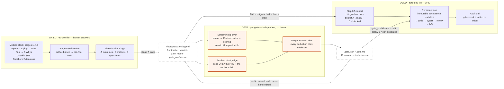
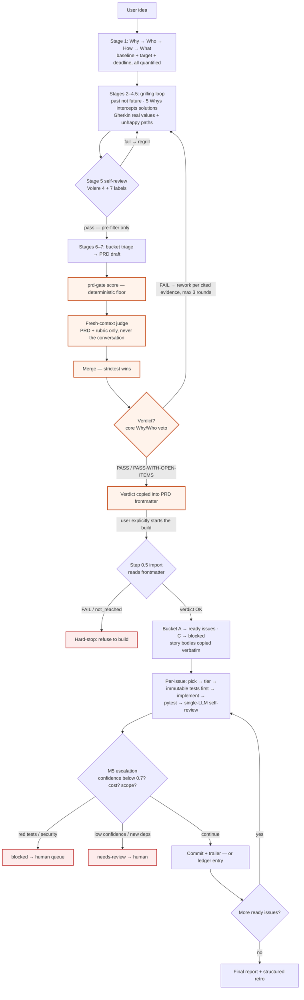

# prd-grill

**Grill → Gate → Build.** Three skills for agentic software delivery: an agent
that interrogates your requirements until they are falsifiable, an independent
quality gate that scores the resulting PRD before any code gets written, and an
AFK pipeline that builds from the gated PRD.

[中文版 README → README.zh.md](README.zh.md) · All documents in this repo are
bilingual: English canonical + a `*.zh.md` / `SKILL.zh.md` Chinese sibling.

## Why I built this

I have worked in software development for over thirty years and have appraised
more than 300 software organizations as a CMMI lead appraiser. What that experience
taught me is that process determines outcome. The organizations that keep
improving their development process and actually make it stick get better
productivity, better quality, and lower cost. The ones with poor results always
turn out to have process problems somewhere.

The two pain points I saw most often: unclear requirements, and reviews that
don't do their job. Requirements are the starting point of a project, the root.
When a requirement is wrong, everything built on it is wrong, and the rework
cost grows with how long the error survives, because defects in work products
amplify downstream. Reviews exist to catch those defects before testing. But
because almost nobody has explicit, quantified criteria for judging a review,
most reviews are a formality. People go through the motions and nobody looks at
the result, so the errors that should have been caught early get expensive instead.

This repository is my requirements-development experience packaged as a skill,
for teams and individuals who want requirements that are real, correct, complete,
and verified, plus a review gate with actual quantified criteria. In principle
the interrogation method applies to any product requirement, not just software.
auto-dev-lite came along for the ride: once the PRD is right, you may as well
let an agent build from it.

— Sam Gao

| Stage | Skill | What it does | Human present? |
|---|---|---|---|
| **Grill** | [`skills/req-dev-lite`](skills/req-dev-lite/SKILL.md) | Interrogates the requirements provider like a trial lawyer (Mom Test, Impact Mapping, 5 Whys, Specification by Example, Cockburn Extensions, INVEST, Volere) until requirements are falsifiable. Lands a local markdown PRD. | Yes (answers questions) |
| **Gate** | [`skills/prd-gate`](skills/prd-gate/SKILL.md) | Scores the PRD on 11 dimensions: deterministic checks + a **fresh-context LLM judge that never sees the elicitation conversation**. Emits a machine-readable verdict and a `requirement_confidence` the build stage must respect. | No |
| **Build** | [`skills/auto-dev-lite`](skills/auto-dev-lite/SKILL.md) | Imports the gated PRD into local issue files and implements them AFK: acceptance tests first (immutable), then code, pytest, self-review, escalation rules, full audit trail. Git optional. | No (escalates when unsure) |

No GitHub dependency. No issue tracker. **Git optional.** Everything is local
markdown files, so the pipeline runs anywhere an agent can read and write files.

## Architecture

Files are the only interface between the three skills. There is no shared state
and no function call, just markdown artifacts with a frontmatter contract, which
is why the pipeline runs in any agent environment. Orange marks the gate and its
hard wiring. Note that the stage-5 self-review and the gate score against the
same anchor file, `quality-gateway.md`; what differs is who executes it, and in
what context.



## End-to-end flow

A `FAIL` verdict is refused at two separate points: the gate sends the PRD back
for rework (max 3 rounds), and the import step refuses to build from it. A
verdict that passed the gate carries its confidence value into the build-stage
escalation decision.



## Install

### Claude Code (plugin, recommended)

```
/plugin marketplace add samgao2000/prd-grill
/plugin install prd-grill@prd-grill
```

That is the whole installation. The three skills trigger on natural phrases ("grill my requirements",
"run prd-gate on the PRD", "start auto-dev-lite from the PRD").

### Any agent that reads skill files (Cowork, Cursor, Windsurf, ...)

```bash
git clone https://github.com/samgao2000/prd-grill
cp -r prd-grill/skills/* <your-skills-directory>/
```

Each skill is a self-contained folder around a `SKILL.md`; no cross-skill file
dependency except the documented PRD contract.

### The gate CLI (optional but recommended)

```bash
pip install "prd-grill @ git+https://github.com/samgao2000/prd-grill"
prd-gate score --prd docs/prd/your-prd.md
```

Stdlib-only. Without it, req-dev-lite still works; PRDs are then marked
`gate_mode: self-reported` and downstream trust is capped (by design).

## Why a gate at all?

Reviews fail in human teams because nobody can say, in numbers, whether a review
was done well. The same failure is now being reproduced in agent pipelines, in a
worse form: the model that wrote the PRD reviews its own PRD in the same context
window, and passes it. Every pipeline has tests for code. Almost none has any
check at all on the spec the code is built from.

prd-gate is that check, with the quantified criteria that human reviews usually
lack. A deterministic layer scores what can be scored mechanically: weasel words,
Gherkin examples with real values, traceability anchors, unhappy-path coverage,
open items with an owner and a deadline. It is plain Python, reproducible, and
regression-tested. The judgment calls (contradictions between stories, gaps in a
flow, causal fallacies, scope overreach) go to an LLM judge that is given only
the PRD and the rubric anchor. It never sees the conversation that produced the
PRD, which is the point.

Two rules connect the score to the build stage. A PRD whose business Why and Who
are not quantified fails outright, no matter how polished its stories are. And a
`FAIL` or unscored PRD is refused by auto-dev-lite; if the gate wasn't installed
and the verdict is self-reported, downstream trust is capped and the build
escalates to a human earlier.

## Methodology provenance (verified)

Nothing here is invented theory. Each practice has a recognized, attributed source,
all re-verified 2026-06-10; full per-source notes, licenses, and the safety review in
[`skills/req-dev-lite/references/attribution.md`](skills/req-dev-lite/references/attribution.md):

| Practice | Source | Role in the pipeline |
|---|---|---|
| The Mom Test | Fitzpatrick, 2013 | banned/mandatory interrogation questions |
| Impact Mapping | Adzic, 2012 | Why → Who → How → What opening; What last |
| 5 Whys (+ Minoura's critique) | Toyota Production System | solution interceptor (stage 2.5) |
| Specification by Example / Gherkin | Adzic, 2011 | AC with real values; bucket A |
| Use case extensions | Cockburn, 2000 | unhappy-path enumeration |
| INVEST | Wake, 2003 | 30-second story screen |
| Volere Quality Gateway (concept, attributed) | Robertson & Robertson | the 4 gate questions; © notice in attribution.md |
| 7-label review taxonomy | carollrollroll/prd-skill (MIT) | gap/contradiction/... labels; criteria rewritten |
| LLM-interrogation / deterministic-verification split | O'Hara 2025, TechRxiv preprint | the architecture of the gate itself |

The gate's dimensions align with the requirement quality characteristics described in
ISO/IEC/IEEE 29148 (verifiability, unambiguity, traceability, consistency,
completeness; our "solution-free" mirrors the standard's implementation freedom) —
cited nominatively, with no standard text reproduced and no conformance claim.
None of these practices are new. What this repo adds is mechanical enforcement of
them at the agent handoff, where until now they depended on a human remembering
to apply them.

## Quickstart (end to end)

```bash
# in your agent, with the plugin installed:
"grill my requirements"            # → req-dev-lite produces docs/prd/<date>-<slug>.md
"run prd-gate on the PRD"          # → score → fresh-context judge → merge → frontmatter verdict
"start auto-dev-lite from the PRD" # → AFK implementation, gated by the verdict

# or score any PRD from the terminal:
prd-gate score --prd examples/personal-crm/prd.md
```

Tests: `pip install -e ".[dev]" && pytest` (19 tests, including the bilingual parser contract).

## Worked examples

Two real, unedited pipeline passes — one per language:

[`examples/calibration-run-logger/`](examples/calibration-run-logger/) (English) is
the more instructive read: the requirement is this repo's own roadmap item, and the
gate stopped its own author — the first drafting session exhausted its three rework
rounds and was halted FAIL by the gate's own rule; the session resumed after one
owner decision and finished PASS-WITH-OPEN-ITEMS (aggregate 0.96), with the final
judge finding bucketed as an owned open item. The example's README documents the
full trajectory, including observed judge variance across rounds.

[`examples/personal-crm/`](examples/personal-crm/) (Chinese — the contract is
bilingual) is a PRD with 8 user stories and its gate report: PASS-WITH-OPEN-ITEMS,
aggregate 0.97. The implementation run from an earlier version of this PRD shipped
8 stories / 51 tests / 94% coverage in 32 minutes AFK.

## Design notes

The three-bucket rule is the backbone of the interrogation: every elicited
requirement ends up as a Gherkin example with real values (bucket A), a
measurable outcome metric (bucket B), or an open item with an owner and a
deadline (bucket C). Anything that fits none of the three is discarded, and the
discard is recorded in the PRD where the next person can see it.

Acceptance tests are immutable. The build agent may never edit a failing
acceptance test, however convenient that would be; a wrong test blocks the issue
and escalates to a human.

When the deterministic layer and the judge disagree on a score, the stricter one
wins. The one exception is the solution-language check, where the lexicon is
only a heuristic signal, so the judge has the final word and the lexicon
evidence is kept alongside for audit.

Every issue leaves a trail: a commit trailer when git is present, an append-only
entry in `runs/ledger.md` when it isn't, plus JSONL run logs and a structured
retro after each session. A verdict that never passed the independent gate is
marked `gate_mode: self-reported` and is treated accordingly downstream.

## What is deliberately NOT here

This is the open pattern, not the whole product. Not included: tuned interrogation
banks for specific industries, the CMMI-grade evidence-evaluation harness this gate's
architecture derives from, multi-model review (M4 here is single-LLM self-review with
an explicit caveat), and calibration data linking gate scores to downstream rework
(roadmap: published after ≥10 gated runs).

## Repository layout

```
skills/req-dev-lite/    interrogation agent       — SKILL.md (EN) + SKILL.zh.md
  references/           methods, question bank, quality gateway (the gate anchor),
                        attribution — each EN + .zh.md
  templates/            prd-local.en.md / prd-local.md (the bilingual PRD contract),
                        user story, snapshot — EN + .zh.md
skills/prd-gate/        gate skill                — SKILL.md (EN) + SKILL.zh.md
skills/auto-dev-lite/   AFK build pipeline        — SKILL.md (EN) + SKILL.zh.md
  references/           import rules (bilingual anchors), issue template,
                        inlined-helpers.py (stdlib fallback)
src/prd_gate/           gate implementation (deterministic layer: zero deps)
tests/                  19 regression tests
third_party/            grill-with-docs, vendored from mattpocock/skills (MIT)
examples/                two worked examples: calibration-run-logger (EN),
                        personal-crm (中文) — each: PRD + gate report + snapshot
.claude-plugin/         plugin.json + marketplace.json (Claude Code install)
```

## Contributing

If software process is your thing, I would like your help. Two areas matter
most right now: calibration data (run the pipeline, keep the `.gate.json` and
the run logs; the planned correlation of gate scores against downstream rework
needs at least 10 gated runs), and trials of the interrogation method outside
software, since nothing in stages 1-6 is software-specific. Issues and PRs welcome.

## Attribution & license

MIT (see [LICENSE](LICENSE)). Methodology sources, license verifications, and the
required Volere copyright acknowledgment are in
[THIRD_PARTY.md](THIRD_PARTY.md) and [`skills/req-dev-lite/references/attribution.md`](skills/req-dev-lite/references/attribution.md).

— Sam Gao ([@samgao2000](https://github.com/samgao2000)), 2026
