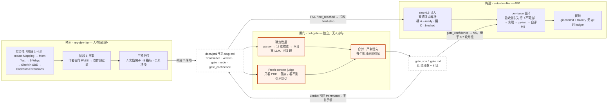
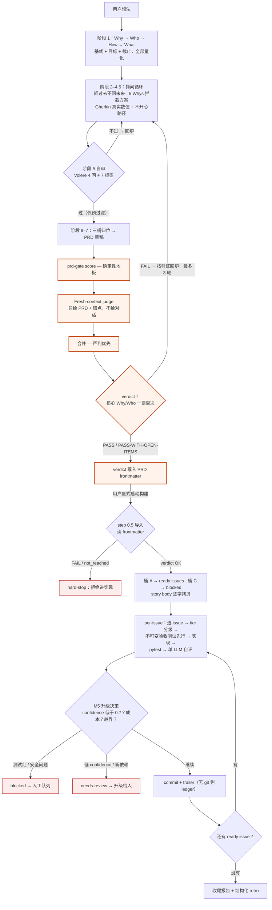

# prd-grill

**拷问 → 闸门 → 构建（Grill → Gate → Build）。** 三个 skill：一个把你的需求拷问到可证伪为止的 agent，一个在写任何代码之前给 PRD 打分的独立质量闸门，一个在过闸 PRD 基础上 AFK 实现的流水线。

[English README → README.md](README.md) · 本仓库所有文档双语：英文为正本，中文以 `*.zh.md` / `SKILL.zh.md` 同名伴随。

## 为什么做这个

我在软件开发领域做了三十多年，作为CMMI主任评估师评估过 300 多家软件企业。这些经历让我深刻理解了"过程决定结果"的含义：持续优化研发过程并使之落地的企业，在开发生产率、产品质量和成本上的结果就比较好；反过来，这几个方面结果不好的企业，查下去总能找到过程上的问题。

我看得最多的两个痛点，是需求不明确和评审不到位。需求是软件项目的起点，是根。需求错了，后续所有开发都是错的；需求错得越多，返工成本越大，周期越长，因为工作产品里的错误有放大作用。评审本来是在测试之前检查中间工作产品、提早发现问题的手段，但因为对"评审做没做好"没有一个明确、量化的评判指标，绝大多数企业的评审只走形式、不看结果，起不到早发现、少返工的作用。

这个仓库是我多年需求开发经验的封装，供开发软件的企业和个人使用，目的是帮助开发出真实、正确、全面、并且验证过的需求——再配上一道有量化指标的评审闸门。理论上这套拷问方法可以用于任何产品的需求开发，不限于软件。auto-dev-lite 是顺手做的配套：需求文档对了，不妨让 agent 直接把软件做出来。

— 高山

| 阶段 | Skill | 做什么 | 需要人吗 |
|---|---|---|---|
| **拷问** | [`skills/req-dev-lite`](skills/req-dev-lite/SKILL.zh.md) | 像律师一样拷问需求提供者——Mom Test、Impact Mapping、5 Whys、Specification by Example、Cockburn Extensions、INVEST、Volere——直到需求可证伪，落地为本地 markdown PRD | 要（人答问） |
| **闸门** | [`skills/prd-gate`](skills/prd-gate/SKILL.zh.md) | 对 PRD 做 11 维度打分：确定性检查 + **从未见过引出对话的 fresh-context LLM judge**，输出机器可读 verdict 与下游必须尊重的 `requirement_confidence` | 不要 |
| **构建** | [`skills/auto-dev-lite`](skills/auto-dev-lite/SKILL.zh.md) | 把过闸 PRD 导入本地 issue 文件并 AFK 实现：先写不可变验收测试，再写代码、pytest、自评、升级规则、全程审计 | 不要（拿不准会升级给人） |

无 GitHub 依赖、无 issue tracker、**git 可选**——全部是本地 markdown 文件，任何能读写文件的 agent 环境都能跑。

## 架构图

三个 skill 之间只通过文件通信。没有共享状态、没有函数调用，只有带 frontmatter
契约的 markdown 产物，所以任何能读写文件的 agent 环境都能跑。橙色是闸门及其强制
接线。注意阶段 5 自审和闸门用的是同一个锚点文件 `quality-gateway.md`，差别只在
由谁、在什么上下文里执行。



## 端到端流程图

`FAIL` 在两个独立的位置被拒：闸门把 PRD 打回回炉（最多 3 轮），导入步骤拒绝在
它基础上构建。过了闸的 verdict 把 confidence 值带进构建期的升级决策。



## 安装

### Claude Code（插件，推荐）

```
/plugin marketplace add samgao2000/prd-grill
/plugin install prd-grill@prd-grill
```

装完即用。自然语言触发：「拷问我的需求」「跑 prd-gate」「从 PRD 启动 auto-dev-lite」。

### 任何读 skill 文件的 agent（Cowork、Cursor、Windsurf 等）

```bash
git clone https://github.com/samgao2000/prd-grill
cp -r prd-grill/skills/* <你的 skills 目录>/
```

每个 skill 都是围绕 `SKILL.md` 的自包含文件夹；除了文档化的 PRD 契约，没有跨 skill 文件依赖。

### 闸门 CLI（可选但推荐）

```bash
pip install "prd-grill @ git+https://github.com/samgao2000/prd-grill"
prd-gate score --prd docs/prd/your-prd.md
```

纯标准库。不装它 req-dev-lite 也能跑——PRD 会标 `gate_mode: self-reported`，下游信任被刻意封顶。

## 为什么需要闸门？

人类团队的评审之所以失效，是因为没人能用数字说清楚一次评审到底做没做好。同样的失败正在 agent 流水线里以更糟的形式重演：写 PRD 的模型在同一个上下文窗口里审自己写的 PRD，然后给自己放行。每条流水线都有对代码的测试，对代码所依据的 spec 却几乎没有任何检查。

prd-gate 就是这道检查，并且带上了人类评审通常缺的量化指标。能机械判定的交给确定性层：weasel word、Gherkin 例子里有没有真实数值、追溯锚点、不开心路径覆盖、未决事项有没有 owner 和截止日期。这一层是普通 Python，可复现，有回归测试。需要判断力的部分（story 之间的矛盾、流程断点、因果谬误、范围越界）交给 LLM judge，但只给它 PRD 和锚点文件，不给引出 PRD 的那段对话。看不到对话，正是它可信的原因。

分数和构建阶段之间有两条硬规则。业务 Why 和 Who 没量化的 PRD 直接 FAIL，story 写得再漂亮也没用。`FAIL` 或没打过分的 PRD 会被 auto-dev-lite 拒收；如果没装闸门、verdict 是自报的，下游信任封顶，构建会更早升级给人。

## 方法论出处（已核验）

没有任何自造理论。每个实践都有公认出处——2026-06-10 全部 web 复核；逐源说明、许可证核验与安全审查见
[`skills/req-dev-lite/references/attribution.zh.md`](skills/req-dev-lite/references/attribution.zh.md)：

| 实践 | 出处 | 在流水线中的角色 |
|---|---|---|
| The Mom Test | Fitzpatrick, 2013 | 禁用/强制拷问问句 |
| Impact Mapping | Adzic, 2012 | Why→Who→How→What 开场；What 放最后 |
| 5 Whys（含 Minoura 批评） | 丰田生产系统 | 阶段 2.5 方案拦截器 |
| Specification by Example / Gherkin | Adzic, 2011 | 含真实数值的 AC；桶 A |
| Use case extensions | Cockburn, 2000 | 不开心路径枚举 |
| INVEST | Wake, 2003 | 30 秒 story 过审 |
| Volere Quality Gateway（概念引用，已注明版权） | Robertson 夫妇 | 闸门 4 问；版权声明见 attribution |
| 7 标签审查体系 | carollrollroll/prd-skill（MIT） | 标签名沿用，判定标准重写 |
| LLM 拷问 / 确定性验证分工 | O'Hara 2025（TechRxiv preprint） | 闸门本身的架构依据 |

闸门维度与 **ISO/IEC/IEEE 29148** 所述需求质量特性对齐（可验证性、无歧义性、可追溯性、一致性、完整性；本仓库的「无方案语言」对应标准所称 implementation freedom）。对标准仅作指名引用：**不复制标准任何原文/定义/表格，不作任何符合性或认证声明**。这些实践没有一个是新的。本仓库增加的东西，是在 agent 交接点上把它们机械化地强制执行——在此之前，它们能不能被执行，取决于有没有人记得去做。

## 端到端快速开始

```bash
# 在装好插件的 agent 里：
「拷问我的需求」              # → req-dev-lite 产出 docs/prd/<date>-<slug>.md
「跑 prd-gate」               # → score → fresh-context judge → merge → frontmatter verdict
「从 PRD 启动 auto-dev-lite」 # → AFK 实现，受 verdict 闸控

# 或在终端给任何 PRD 打分：
prd-gate score --prd examples/personal-crm/prd.md
```

测试：`pip install -e ".[dev]" && pytest`（19 个，含双语解析契约测试）。

## 完整示例

两个真实、未经修饰的流水线全程产物，一中一英：

[`examples/calibration-run-logger/`](examples/calibration-run-logger/)（英文）更值得细读：需求就是本仓库自己的 roadmap 项，而且**闸门拦下了它自己的作者**——第一次起草会话三轮回炉用尽、按闸门自己的规则以 FAIL 叫停；owner 拍板一个决策后续跑，最终 PASS-WITH-OPEN-ITEMS（加权 0.96），最后一个 judge 发现转成了有 owner 有截止日期的未决项。该目录的 README 记录了完整轨迹，包括轮间观察到的 judge 方差。

[`examples/personal-crm/`](examples/personal-crm/)（中文——契约本身双语）：8 条 user story 的 PRD + 闸门报告（PASS-WITH-OPEN-ITEMS，加权 0.97）。该 PRD 早期版本的实现 run：8 个 story / 51 个测试 / 94% 覆盖率，AFK 32 分钟。

## 设计要点

三桶规则是整个拷问的骨架：每条挖出来的需求，要么落成含真实数值的 Gherkin 例子（桶 A），要么落成可测量的 outcome metric（桶 B），要么落成有 owner 和截止日期的未决事项（桶 C）。三桶都进不去的，丢弃，并且把丢弃记录写进 PRD，让下一个人看得见。

验收测试不可变。构建 agent 永远不许改一条失败的验收测试，改一行就能让测试通过也不行；测试本身错了，issue 标 blocked，升级给人处理。

确定性层和 judge 对同一维度给分不一致时，取更严的那个。唯一例外是方案语言检查：词表只是启发式信号，judge 有终裁权，词表的证据保留在报告里供人复核。

每个 issue 都留痕：有 git 时是带 trailer 的 commit，没有 git 时是 `runs/ledger.md` 里 append-only 的台账条目，外加 JSONL run log 和每次会话之后的结构化 retro。没过独立闸门的 verdict 标 `gate_mode: self-reported`，下游按这个标记降级对待。

## 刻意不放进来的东西

这是开放的模式，不是完整产品。不含：行业定制的拷问题库、本闸门架构所源自的 CMMI 级证据评估系统、多模型评审（这里的 M4 是带显式声明的单 LLM 自评）、闸门分数与下游返工率的校准数据（roadmap：积累 ≥10 个过闸 run 后发布）。

## 参与共建

如果你对软件开发过程感兴趣，欢迎一起来完善这些 skill。眼下最有价值的两个方向：校准数据（跑一遍流水线，保留 `.gate.json` 和 run log，闸门分数与下游返工率的相关性分析需要至少 10 个过闸 run）；以及把这套拷问方法用在软件之外的需求开发上试一试，阶段 1–6 里没有任何东西是软件专属的。Issue 和 PR 都欢迎。

## 许可证与致谢

MIT（见 [LICENSE](LICENSE)）。方法论出处、许可证核验记录与 Volere 版权声明见
[THIRD_PARTY.md](THIRD_PARTY.md) 与 [`attribution.zh.md`](skills/req-dev-lite/references/attribution.zh.md)。

— 高山 Sam Gao（[@samgao2000](https://github.com/samgao2000)），2026
